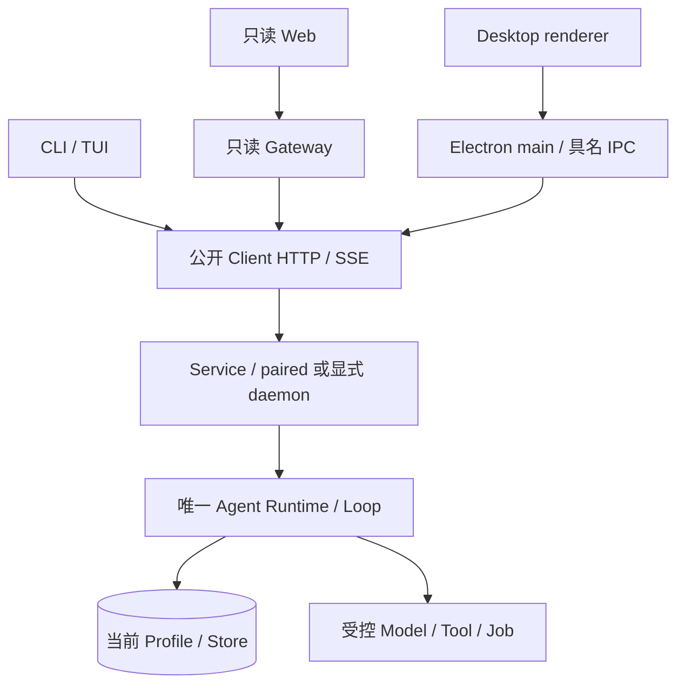

# 系统组成与运行拓扑

当前正式源码只有根 manifest 中的八个 workspace：AI、Agent、Client、UI、Service、CLI、Desktop、Web。`apps/kite-cli` 仅保留旧源码，运行依赖已删除，不属于可运行产品。模块职责见[依赖边界](dependencies.md)。

图中箭头表示业务请求与数据访问，静态 import 方向另见 manifest。CLI/TUI 与 Desktop 的宿主分别拥有其配套 Service 的进程生命周期；私有 bootstrap/发现用于准入，不提供第二条业务通道。显式 daemon 与 Web 的组合由 [Service daemon](../../../apps/service/src/daemon/README.md)负责。

Service 通过[可信装配](../../../apps/service/src/assembly.ts)和[配置](../../../apps/service/src/configuration.ts)注入模型、权限、工具与平台资源。Agent 的 [Runtime](../../../packages/agent/src/runtime.ts)、[Loop](../../../packages/agent/src/loop.ts)及[Store](../../../packages/agent/src/storage/README.md)共同保持原 Command、Run、Execution 与持久事实；客户端与连接不拥有执行权。

当前 Profile 的数据根、development 与正式候选的选择见[本地开发](../local-development.md)。相同 Profile/Store 也不允许另一进程凭连接成功重放未知请求，写入身份、owner 锁和恢复结算仍由 Store 裁决。

窗口关闭、客户端观察停止、Service drain 和工具进程实际退出是不同事实。正常关闭须等待所属资源收尾；未知结果不能根据 UI 消失或 PID 缺失推定成功。准确边界与资格见[当前契约](../../active/unified-agent-boundary.md)、[Service](../../../apps/service/README.md)和[Desktop](../../../apps/desktop/README.md)。

旧 Host/Kernel/SPI 实现的[历史说明](https://github.com/ferqx/kite-code/blob/d5407cfe4319c5a84d530f63b1d0a0123218ad34/docs/development/architecture/topology.md)只供删除前设计与证据追溯，不能恢复为当前 owner 或运行入口。
