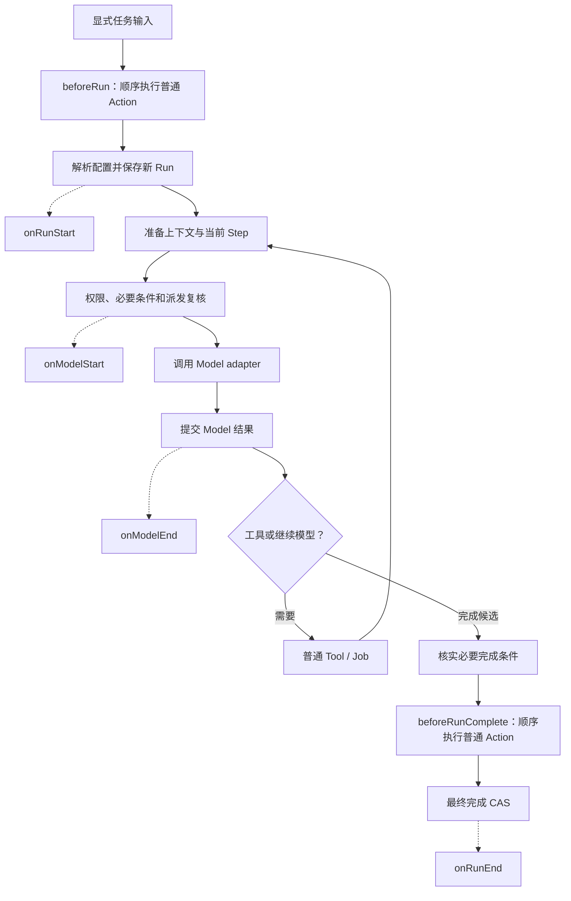

# 通用 Agent

正式构建内联[声明的普通 JS 依赖](scripts/bundled-dependencies.ts)，包括独立 Web extraction Worker 的 Readability/Turndown；keyring、Files Node-API、tree-sitter WASM 与 jsdom 动态资源仍沿原外部资产闭包核验。生成物扫描、原许可全文及精确资源复制归 [Terminal owner](../../apps/cli/docs/terminal-release.md)，不改变权限或 Worker 生命周期。Windows 制品原 HANDLE 的类型/大小/身份、完整字节/SHA 和私有批量复制边界归 [platform owner](src/platform/README.md)。

`@kite-ai/agent` 正在按 [V1.3](../../docs/plans/unified-agent-refactor-v1.md)实施。当前支持显式装配模型、外部工具、Action/Query、一个默认 Loop 与具名 Store；[Service](../../apps/service/README.md)、[Client](../client/README.md)和[通用 UI](../ui/README.md)已通过真实 HTTP/SSE 联验。正式 Terminal 已消费通用 TUI；完整客户端迁移和正式旧路径退役仍按门禁核对。已完成范围和未运行场景见[实施证据](../../docs/plans/unified-agent-refactor-v1-progress.md)。

公共当前会话视图保留最近的有限 Run/Execution 历史及原未结束／未知工作，长会话不会因最早200项投影而丢失当前 Run或较早的 live Job。查询只反映原事实，不改变取消和恢复资格；精确范围与真实长会话验收由[Store owner](src/storage/README.md#当前会话视图)维护。

## 入口与职责

[扩展契约](src/extensions/index.ts)的 `lifecycle.beforeRun/beforeRunComplete` 分别在显式任务输入的启动前与正常完成前选择本 namespace 的已注册 Action。Core 在模型配置解析前、最终完成 CAS 前按注册顺序调度普通真实 Action；内部 child 激活和自动 Job report 不进入这两个业务钩子。稳定 Command ID 去重，完成重试和冷读不重复执行，失败保留 Action 自身结果，不替代主 Run 的业务结果。Action 继续通过原受控 operations 请求子执行；`resultDelivery:caller` 仅将普通 child 的自动交付标为调用扩展所有，实际状态、结果与取消证据保持。省略时保留原会话投递；它不能与必要结果义务或 after-turn 自动报告组合。[生命周期测试](test/isolated/execution/run-lifecycle.test.ts)与[结果交付测试](test/isolated/child/result-delivery.test.ts)验证这些通用合同，并核实未安装命名扩展时空标题及控制修订保持不变。

[会话命名扩展](src/business/session-title/index.ts)用启动前 Action 先保存首条原文规整空白后的前10个Unicode码点及自有 CAS marker，在首次主任务满足正常完成条件后、最终成功状态提交前，通过按本轮选定模型装配的无工具内部 child 尝试一次可读标题。标题专用副本去掉首尾空白，将连续空白合并为一个空格，再分别截取兜底的10码点或命名输入的8192码点；按需读取原文，只构造有界副本，原消息及主模型输入保持不变。全为空白时保存“新会话”且不发起命名模型请求。扩展持有10秒取消、32KiB输出限制、[标题校验](src/business/session-title/title.ts)与原 Session rename CAS；AI 输出裁至10码点后再次校验可读性，拒绝只剩表情、数字或符号的标题。模型不可用、重试等待、失败和迟到手动改名仍保原文兜底或手动名称。独立子会话及 caller 交付隔离正文，无 Core 标题开关、公共用途字段或专用恢复格式；后续输入和冷读不补发命名。[命名集成](test/isolated/execution/session-title-generation.test.ts)核真实 SQLite、连续空白与原文隔离、取消、手动竞争、已有空标题历史不补命名、父上下文隔离及普通主恢复点；[Store](src/storage/README.md#session-标题写入)只保存消息和执行显式 rename，不再从用户正文推导标题。设计理由与限制见[生命周期取舍](../../.agents/notes/implemented/architecture/2026-10-18-run-lifecycle-extension-actions.md)。

需要解释的首输入先经可信宿主 `sessionInputMetadata.preserve` 保存本会话标题兜底，再捕获解释所用控制修订；该接点不属于 Run 的业务钩子，不准入 Action、Tool、Job 或 Model。默认标题实现核真实 public/raw、主体、初始控制与空历史，并沿稳定 rename Command 和原 CAS 保存本地名称；保留的原注册事件核手动改名，注册锚点不可核时拒绝推断。准确业务随后沿 public/raw/decision/business 回执核原文；首条未决输入经真实澄清形成首业务时，另核原待决、准确 clarifying input、新决定与业务的完整链，标题继续锚定首条原文，原启动 Action 只补 marker。明确独立新任务不借此前待决输入命名，手动标题仍受原 CAS 保护。AI 只在准确业务满足正常完成条件后、最终成功状态提交前生成；解释轮本身不触发业务 Action。全空白只可从真实公共输入登记为待澄清，不取得工作选择或执行权。

- [根入口](src/index.ts)：`createRuntime`，import 不打开资源。Runtime 的短命令受理与异步运行分开；模型和工具等待不占控制入口。
- [扩展入口](src/extensions/index.ts)：具版本 Tool/Action/Query、JSON schema、公开内容 envelope 与有限操作。扩展只获得当前 Session、自有 namespace 的记录 CAS、公开 Run/Execution 和受控子工具；不取得 SQL、owner 或完整运行状态。
- [权限策略与 Shell 授权](src/permissions/README.md)：独立 `@kite-ai/agent/permissions` 与 `/permissions/shell`，统一三策略、权限约束、Shell AST/危险拒绝、摘要和最终 scope；Service 只注入宿主事实，Loop 保持通用授权接口。
- [普通问题入口](src/tools/ask-user/README.md)：`@kite-ai/agent/ask-user` 的纯工厂通过原 `requestInput` 提供 1–3 题、原选项和自由回答，并将原答案解释为模型与历史文案；默认选择及 child 禁用归 Service。
- [计划与 receipt 验证入口](src/business/planning/README.md)：显式业务工厂、真实用户计划审阅、来源绑定的步骤回执、required 判定和准确 waiver；共享扩展端口与唯一 Loop。完整文件/Artifact/命令/MCP 验证及自动修复继续按该 owner 范围实施。
- [Store 端口](src/storage/port.ts)：宿主使用的具名查询和事务；[记录](src/storage/types.ts)保存业务事实，非完整内存 State。
- [上下文选择与结果](src/storage/sqlite/context/README.md)：当前选择、完整历史和准确结果引用分开保存；双游标读取固定同一选择与顺序上界。
- [Profile 入口](src/profile.ts)：`selectProfile({dataRoot, profile})` 只读确定规范 data-root、逻辑名称与稳定 `profileAccessKey`，供 launcher 在启动前固定目标；import 与选择均不创建目录、取得锁或打开数据库。
- [离线维护入口](src/maintenance/README.md)：显式备份／恢复、DB9公共扩展申请的v18及DB8原Workspace申请的v17资产，以及持准确Store排他权的空间／单会话历史与无引用附件GC；维护自身连接／句柄关闭未确认时保原资源、临时目录及Profile排他权至实际宿主退出，安装维护和完整平台资格按实施进度记录。
- [Profile 使用权入口](src/platform/README.md)：`@kite-ai/agent/profile-access` 供 Bun 宿主显式取得共享使用权，可信一次性 helper 可取得继承 fd 的同一锁；纯 Node 身份入口不引入 FFI 或 acquire。
- [制品使用权入口](src/artifact-access.ts)：显式候选 shared/exclusive OS 使用锁，import 不 acquire，不授予 Profile/Store/执行权限；终端安装器与运行中的宿主共享此协议。
- [资源入口](src/resources.ts)：`createWorkspaceSerialLocks(profile)` 显式建立同 profile/Workspace 的共享 OS 串行键后端，宿主注入 Runtime；import 不打开资源，普通扩展不取得锁对象。
- [进程只读观察入口](src/process-observation.ts)：可信宿主在实际启动后显式读取原 PID 的 PPID、微秒出生和 kernel 状态；import 不加载 native 库，冷 decoder 不观察当前进程。观察不授予 spawn、信号、后代枚举或所有权，具体交接由 Shell／MCP／Service OAuth owner 保存。
- [SQLite 入口](src/sqlite.ts)：显式打开新 profile、一个专用 Worker；macOS 的解析／Store 原 Worker 收尾通过[平台 owner](src/platform/README.md)等待原 Mach 权终态和准确释放，再交接原锁。具体字段和事务由[基线迁移](src/storage/migrations/0001-baseline.sql)、[具名操作](src/storage/sqlite/operations.ts)维护；三端与完整资源门禁仍按进度保留。
- [Store 目录](src/storage/README.md)：原 Store 与实际 root 创建主体的有限 keyset 分页；Workspace 保持认证 profile 范围，空 Workspace 不依赖 Session 才可见。
- [唯一 Loop](src/loop.ts)：只使用模型/输入/执行契约；工具参数只有在完整模型响应保存后才能派发。
- [模型工具表面](src/model-tools.README.md)：leaf 用纯 `ToolDefinition.model` 声明公开名称与字段，UnifiedExecution 在任意 ModelAdapter 边界统一投影、校验并转回原内部输入；内部定义、权限和 baseline/key 保持。历史只记录原公开名称及精简字段映射，Inspector 使用封存的实际工具表面，不从今天目录重建；具体名称表、opaque JSON 与隐藏工具边界归该 owner。
- [来源入口](src/sources.ts)：宿主显式配置的项目指令适配器，根 import 不读取文件。按可信目标链读取 AGENTS.md/CLAUDE.md 的实际内容摘要，相关新增、修改、删除进入派发前复核。具体 factory 的 disposer 与知识读取作用域保原文件资源到关闭确认；纯 `ContextSources` 及来源身份保持。
- [文件入口](src/files.ts)与[普通文件 Tools](src/tools/files/README.md)：显式 Workspace 的目录 FD、完整内容基线与精确修改；行读取、glob、查询分页保留明确范围。大正文使用完整 Artifact，显式分页继续保留选择范围。
- [Files 原生模块](native/files/README.md)：固定 cap-std／napi-rs 的 Node-API 能力 owner，官方 SDK 补齐 Windows 完整身份、句柄发布及关闭未知；build 携带固定原生资产，运行期无编译或旧 FFI 回退。
- [Artifact 入口](src/artifacts/README.md)：不可变文件先发布，再事务登记原 Store、主体、Session 与准确授权 scope；相同 hash 不授予其他 scope 读取资格。
- [完整 Model 正文与实际输入检查](src/model-body/README.md)：原产物正文与大 Model/Auto 请求以准确 scope 的不可变 Artifact 交接，Provider 前完整展开并核实 hash；只读原 Execution 请求及固定上界调用目录不捕获现在来源、不初始化 Provider，Worker 仍使用有限传输。
- [上下文显示估算](src/context-estimate.ts)：独立 `@kite-ai/agent/context-estimate` 纯函数，沿原 cl100k 计数消息、调用与工具 Schema。每次估算按不拆 Unicode scalar 的最多 1024 个 UTF-16 code unit 分块，完整计入全部原字符；短文本保持原计数，长文本块边界允许近似差异。单次最多 128 块的局部缓存避免连续重复大段触发 BPE 病态耗时，调用结束不保留文本。取舍见[估算分块](../../.agents/notes/implemented/bug-fix/2026-10-15-context-estimate-bounded-tokenization.md)。最近请求显示优先取准确原请求已返回的输入统计，该 leaf 提供缺失时的独立本地估算；容量只接原冻结模型的明确窗口／输出预算，不猜容量、不修改请求或取得派发资格，累计 Provider 用量不代替当前请求大小。
- [Model 用量结算](src/execution/index.ts)消费独立 `usage` 快照，在成功、失败和取消结果中保存已收统计及原始明细；用量不授予成功终态或 Tool 派发资格。未收到的字段仍未知，无 SQL baseline／公开 HTTP schema 变更。真实 SDK→Core→SQLite→冷只读的[回归](test/isolated/execution/model-usage.test.ts)核四种结算；算法与取舍归 [AI owner](../ai/README.md)及[用量决定](../../.agents/notes/implemented/bug-fix/2026-10-16-provider-token-accounting.md)。
- [完整 Model 输出](src/model-output/README.md)：原 Execution linked segments 的完整 EOF、历史展开与 child 正文；私有 reviewer 另封存有限答案凭据，最终 Store 只核原 descriptor 和不可变登记，不以 preview 代替全文。
- [Task 入口](src/extensions/task/README.md)与[Shell Tools](src/tools/shell.README.md)：可信角色和原 Job 的普通控制工具，使用同一受控 operations；容量、输入与实际执行资格由 owner 记录。
- [Shell Jobs](src/jobs/README.md)：显式 POSIX、macOS host／confined 和 Linux host／confined 的可信资产、执行范围与原进程结束证明；正式 verifier 已接准确只读 Profile Skill 来源，Linux 原生资格仍缺。
- [Web Fetch 入口](src/tools/web-fetch/README.md)：普通 `web_fetch` Tool、逐跳资源准入与真实 DNS/socket 绑定，惰性使用已构建的无执行能力解析 Worker；大正文保留完整 Artifact。
- [配置入口](src/config/README.md)：JSONC 评论保留与短锁 CAS、分层解析、脱敏封存、opaque credential refs 和惰性 OS backend。默认 Service 的每 Run 解析由 Service owner 负责。
- [Skills](src/skills/README.md)与[MCP](src/mcp/README.md)：摘要发现、按需正文/资源与具有版本的普通 Tool 快照；leaf import 不连接远端或启动进程。
- [Skill Workflow](src/business/skill-workflow/README.md)：有条件 activation、inline/fork、严格输出和普通核验 Job；业务记录及必要条件归扩展，沿用唯一 Loop 与实际父子权限。

未提交普通Action的结果不以Command.applied视为完成；同Session后续普通派发须继续核原receipt主Execution。准确Store/owner观察、合法detached Job与未提交Action的区分，以及真实最终提交故障测试归[Store owner](src/storage/README.md#未提交普通-action-的串行边界)。

MCP强制重连的建立失败收尾由[MCP leaf](src/mcp/README.md#强制重连持久发布与原事实)沿原operation有界等待真实Job终态，再核完整停止证明。运行中新holder的发布失败继续隔离；超时或迟到结算不追改原unknown，通用Execution与Query合同保持。

## 生命周期扩展

生命周期入口只有一层 `Extension.lifecycle: LifecycleHooks`。`Run` 指一次持久任务执行，`Model` 指其中一次模型尝试；Agent 实例可以经历多次 Run，每个 Run 可以调用多次 Model。命名区分两种合同：`before*` 选择由 Runtime 等待的普通业务 Action，`on*Start/on*End` 订阅只读事件。用词参考 [OpenAI RunHooks](https://openai.github.io/openai-agents-python/ref/lifecycle/) 的 start/end 事件与 [LangChain middleware](https://docs.langchain.com/oss/javascript/langchain/middleware/custom) 的执行阶段；两者并非统一行业协议，不把异步通知冒充可修改状态的 before/after middleware。

| 时点 | Extension 入口 | 能力与执行边界 |
| --- | --- | --- |
| 显式任务输入准备前 | `lifecycle.beforeRun` | `run.start/input.follow_up` 配置解析前，纯选择自身全局注册的 Action；实际业务经过原权限、取消与 operation key |
| 新 Run 激活后 | `lifecycle.onRunStart` | Run 保存成功后发布；内部 child 和自动 report 的新 Run 同样可观察，原 Run 恢复不重发 start |
| 模型输入准备与派发前复核 | `context.capture/captureBatch` | 从自有 namespace 的只读投影贡献带来源的 `user` 数据；可能因刷新、重试多次读取 |
| Model 派发准入后 | `lifecycle.onModelStart` | 原派发已确认且取消已复核，在进入 adapter 前发布；权限拒绝或派发前取消不发 start |
| Model 结果提交后 | `lifecycle.onModelEnd` | 只读观察实际成功、失败、取消或未知结果；每个重试 Execution 保留自己的身份与结果 revision |
| 显式输入的 Run 正常完成前 | `lifecycle.beforeRunComplete` | 必要条件已满足后、最终成功 CAS 前选择普通 Action；不是完成事实，也不替代必要条件 |
| Run 终态提交后 | `lifecycle.onRunEnd` | 只读观察实际完成、失败、取消或中断；不等同于后台工作结束或资源 disposer 完成 |

所有回调均可省略。两个前置回调接收冻结的 `RunBoundaryEvent`，返回 `LifecycleAction` 或 null；启动前的 `run` 为 null，完成前为原活动 Run。只从全局注册扩展选 Action，按注册顺序逐个选择并等待执行，不提供 `next()`、可包裹的 Loop 或重试控制。内部 `child.start` 和自动 `job.report` 不执行这两个钩子，避免 Action 创建的 child 再从完成钩子递归创建 child；子任务的正常 Tool/Action/Job 能力继续通过原 operations 工作。恢复不重跑启动前 Action，完成前仍按原命令身份去重。

四个观察回调接收 [ModelStartedEvent/ModelSettledEvent/RunStartedEvent/RunSettledEvent](src/extensions/lifecycle.ts) 的冻结有限事实，包括来源 Store/Session/Run/Command、稳定 `eventId`；Model 另含原 Execution、定义与 attempt，Model 结束事件另含结果 revision 和标准用量；结束事件均含实际状态。缺失用量为 null，不推算 total；不提供请求、响应、reasoning、凭据、Provider raw 或内部 owner。详细结果继续通过宿主原 scope 的读取契约取得，事件身份本身不授予读取或执行权。

正常路径由 Runtime 平铺推进，虚线表示发布通知，不等待回调完成：

失败或取消直接保存实际终态后发布结束事件；Model 准入失败可以只有 end，没有 start。最终完成 CAS 若发现新输入或义务变化，会回到原 Loop 或完成核对，前置业务 Action 不因此重发。内部 child 复用相同 Run/Model 主链，省略图中的两个业务钩子；自动 report 从创建新 Run 开始。context 是可重复的来源捕获，不另叠一条修改同一模型输入的 beforeModel 转换链。

Model 的 start/end 均绑定该次实际冻结 Step；Run 的 start/end 均绑定初始 Run 配置，不随后来 Step 或其他 Session 的目录替换。通知仅在原事实或准入 ACK 可确认时发布；配置拒绝无 Run 时不制造事件，完成 CAS 重试不重复发布。冷读和重复原 Command 不重放；恢复只发布本次推进到的 Model 边界和新到达的 Run 终态。已有必要条件与 completion governance 继续负责成功终态，观察回调不能更改已提交结果或创建受控工作。

[观察队列](src/extensions/lifecycle.ts)按同一 callback 的发布顺序交付，最多保留128个在途/排队通知，每个 callback 最多16个排队项；超出丢弃新通知，异常只停用对应 callback。不同 callback 独立推进，不承诺彼此完成顺序，也不采用 middleware 的反向退栈顺序。start 表示事件发布边界，回调可能稍后才执行。执行和 Runtime 关闭不等待观察 Promise，不为其保留 Run lease、permit 或 Store；关闭丢弃待交付通知。进程内同步阻塞不能由此抢占，也不构成恶意代码隔离。需要保证发生的后续业务仍通过原 Action/Job/必要条件登记，不依赖通知必达或 exactly-once。

[真实 SQLite 回归](test/isolated/extensions/lifecycle-observers.test.ts)覆盖开始/结束 ACK 屏障、注册顺序、child 无业务钩子重入、成功/失败/取消/拒绝、模型重试、原 Run/Step 版本绑定、冻结与脱敏、慢/异常观察和冷读零重放；[真实进程退出后的恢复](test/isolated/extensions/lifecycle-recovery.test.ts)核原 Run start 与已结算 Model 不重发；[队列测试](test/lifecycle-observers.test.ts)核有限压力、交付顺序和关闭丢弃。旧 `runLifecycle.prepare` 迁移至两个 before 回调；曾使用的 `afterModel/afterRun` 统一为 `onModelEnd/onRunEnd`，不保留双入口。原 `before_start/before_complete` 持久 Command key 及 `model.settled/run.settled` 事实身份保持稳定。设计边界见[生命周期观察决定](../../.agents/notes/implemented/architecture/2026-10-18-settled-lifecycle-observers.md)。

## 当前执行与恢复边界

Runtime 的公共 admission 方法由同一个 `accountEntry` 同步封门并计入关闭等待；方法体不重复同一首行 `runtime_draining`。异步等待后的复核、控制与只读入口、私有回调及不同错误码保持各自职责。原生命周期、Fork 和恢复验收及保留理由见[默认主链精简决定](../../.agents/notes/implemented/simplification/2026-10-11-service-agent-default-composition.md)。

创建与命令写入核对原 `expectedStoreId`，同一 ID/语义返回原事实，内容冲突拒绝。统一执行先保存意图和派发依据，再调用真实适配器；权限、取消与必要依据在派发边界复查。已派发工具没有可核实结果时保留 `outcome_unknown`，不以普通异常推断没有外部效果。模型不完整响应不能启动工具。

`run.start` 与公开 `input.follow_up` 的可选 `selectedSkills` 保存原有限数组并进入请求摘要，Core 不解析名称或读取 Skill 文件。宿主须同时提供 `resolveRunConfiguration` 和显式 `supportsSelectedSkills:true`；未支持时原 Command 持久拒绝，零 resolver/Model/Tool，历史同 ID 仍先核原摘要。省略与空数组是不同意图，活动 steer 不能改变此项。默认 Service 的目录解析、子任务实际 ID 继承与快照由 [Service owner](../../apps/service/README.md)负责。

同两种命令的 `extensionInputs` 是通用 `{extensionId,definitionVersion,input}` 原始意图数组，保留顺序、重复项以及省略与空数组的区别；Core 不解析扩展 payload。只有 resolver 与 `supportsExtensionInputs:true` 同时存在才支持，否则原 Command 持久拒绝且零 resolver/Model。活动 steer 不支持此字段。宿主负责具体版本与输入验证，initializer 在首次 Model 前只创建必要元数据，动态 requirement 自动绑定注册 Extension 的判定器；缺实现不能降为普通提示。

启动器用 `@kite-ai/agent/profile` 的 `selectProfile` 固定预期身份；SQLite 打开复用同一解析，再校验私有目录、no-follow 路径并取得协调锁。尚不存在的 data-root 从现存祖先规范化，profile 数据单元替换不改变外部协调键。选择结果不授予读写或锁权限。

新数据使用显式 `dataRoot/profile` 下的 `core.db`，不会发现或导入旧 Kite 文件。协调锁位于数据单元外，Session 的 OS 锁先于持久 owner generation；正常释放复查命令与活动工作。空列表读取后、实际释放前新接受的准确 Session 命令，在原执行组没有未结算工作时由同一 generation 继续处理；有限宿主观察与 acquire/release 共用阻塞条件，不赋予恢复权，详见[Store owner 边界](src/storage/README.md)。普通重启读取原业务结果；遗留在途/未知工作限制相关执行，不自动接管或重跑。SQLite 内容、回执和变化通知在同一事务提交，网络观察不参与完成条件。

`cancelCommand` 与 `cancelWork` 在短事务中核对原主体、Session 和准确目标；取消从指定 Command/Run/Execution 的实际执行 seed 沿 attached 边传播，父终态不隐藏活跃后代，detached sibling 不被局部取消扩大。普通 Tool 的 execution cancel 不标记其共享 Run Command。Session 全量停止写持久根工作边界阻止迟到因果派发，后来明确新顶层工作仍可开始；foreground-only 停止只覆盖当前 Run 与 attached 后代。受理回执为 `cancel_requested`，不冒充停止确认，也不覆盖真实终态。

Model 的实际 Store 派发事务以 `cancelled_before_dispatch` 拒绝时，原未派发尝试收束为 `cancelled`，不等待本地 abort 通知到达。输入、授权、条件等派发前钩子或已派发 Provider 的同名错误仍是原失败；原错误、执行身份、资源释放和零适配器派发事实保持。[确定性控制回归](test/isolated/execution/control.test.ts)覆盖持久取消与通知交错及这些拒绝边界，真实多会话流式负载继续核取消隔离与全部终态。

接收实例最多保留 256 个待派发 Session，以 250ms 起测间隔等待正常 owner 交接；本 owner 从持久 Command/Execution 观察精确取消，再停止自己的对应句柄。取得安全派发边界失败后停止该 Session 的自动轮询，Command 查询显示带本实例身份的局部 `dispatchFailure`，不改写持久完成事实，也不隐式恢复或重放；其他 Session 可继续，准确取消仍可用。冻结 owner 不被抢占，网络订阅释放不参与这条路径。Worker 按控制/正文/查询加权调度，预留控制容量；可选 `onTiming` 观察实际排队、SQL 和 COMMIT，观察异常不能影响提交。

已登记的根 Session 仍有本实例 hot operation 时，空 accepted 列表不删除其轮询登记；peer Service 后接纳的准确根 Session Command 继续交给原 owner 的 pump。后台 Job 等待 process/Workspace permit 不阻止主 Action 返回，但不允许第二 Job提前启动。原 generation、未提交 Action、cold/unknown和关闭守卫仍在现有派发路径核实；不扫描全 profile，也未取得跨 child Session 的新 intake 资格。[确定性交接测试](test/isolated/execution/owner-handoff.test.ts)在首个命令前安装真实空控制轮询屏障，核两个 Store/Runtime、原 owner 排他锁、同 generation、planned Job和各启动一次；当前 5 tests / 36 assertions，原[真实 Shell Service](../../tests/isolated/unified-agent/shell-service.test.ts)四场景 / 51 assertions通过。取舍与原 idle 交接边界见[同一 Note](../../.agents/notes/implemented/bug-fix/2026-10-03-idle-owner-intake-keeps-original-generation.md)。

受控 Job 先按稳定 operation key 原子登记 Command 与 planned Execution，applied 回执只表示创建，实际 handle 由 `markRunning` 保存。普通 Tool 的 namespace 从原 Run 或准确成功 Model 的实际定义绑定核实；后者还核对 Model 请求中的工具版本、同 Store/Session/rootWork 和原 Run，受控无 Run 子操作核对有限父执行链。namespace 资格不替代实际工具授权。Job 继承来源、根工作和必要业务约束。attached/detached 只改变局部父取消边，根工作停止与删除仍有效。终态与目标 Session/contextSelection 的 pending 或 suppressed 投递事实同事务保存，不自动续轮或调用模型。

Job.start 的可选只读 `dispatchAuthorization` 来自资源等待后的最终 decision，仅在原 `markDispatching` 事务接受权限与 controlReads 后交付。Core 克隆 revision/namespace/version/data；人工批准和自动批准保留原 decision snapshot，包括实际 childPermissions 的父子交集树。它是通过派发边界的宿主执行范围元数据，不是新 grant，不覆盖硬门禁或取消。默认 macOS／Linux Shell 与正式 verifier 消费各自实际定义的全部原策略交集；Core 不认识 Shell mode/路径含义。

本地子 Agent 通过固定宿主 `childConfigurations` 与普通 `operations.ensure({request:{kind:'agent',configurationId,input}})` 登记。Store 原子创建 child Session、Command 与 carrier Job，Core 取得每父 Run 的有界子许可后激活 child Run，复用同一个 `executeRun/defaultLoop`。父 Tool 等待子工作不持有模型槽；嵌套子工作各有直接子许可，不设置隐藏回合上限。子 Tools/Jobs/namespace 不得超过实际父 Step 允许范围，准确调用执行父子 policy 交集；Ask 与 Review 同时适用时保留双 proof。可信 fresh resolver 使用真实 Store Workspace，新 carrier 重新解析绑定；其 `records.forExtension(id).get(key)` 只读实际父 Session 已绑定 namespace，Host 自动封存有限完整投影 digest/read-set，在 carrier 创建及 child activation 的原事务复核，缺失读取也参与 CAS。getter 随 resolver 结束关闭，不交给 Model/HTTP；空读集不为 runless 工作虚构祖先 Run。同原 key 的冷热查回不重新解析或启动。后台 Job 真正结束后才释放原 binding lease。后台 child 完成前保留根执行组 OS owner；精确取消按 attached 关系传播，根停止仍阻止迟到后代。真实 child SIGKILL 恢复保留原 scope、partial、执行身份与未知效果，不自动重新调用模型或工具。

可信宿主的 `readRunExtensionRecord({sessionId,runId,extensionId,key})` 只观测准确当前 Store、实际 Run manifest 所含 namespace 的原记录，拒绝外部 origin/fork provenance；返回 clone/freeze。它属于 Runtime 的普通只读资源生命周期，不取得执行 owner、不初始化 Provider，也不增加 HTTP 或 Model 能力。Service 可由原 immutable activation anchor 读取最低审批，不能用模型输入或有限当前视图猜权限。

普通 Task 的模型表面由[六工具 owner](src/extensions/task/README.md)维护，默认通用 child 异步受理并在 carrier ensure 事务保存有限 `agent_completion` 订阅，不让模型选择 required/background/after_turn。稳定 Agent 以 child Session 为身份，每轮仍有准确 carrier、Run、配置、结果 revision 和取消范围。已受理 child 在工作选择使其暂缓时保留原 planned carrier，释放槽位后等准确资格恢复，激活前重新核当前权限；具体边界和回归由同一六工具 owner 维护。可信内部调用的 required 义务、caller 交付及旧记录恢复继续保持各自封存合同；它们不成为普通模型的兼容 alias。

child 在实际激活时持久保存 `deadlineAt=startedAt+1_800_000`，根 Run 的 `deadlineAt=null`。Runtime 计时器与 SQL 最后派发使用同一固定期限，到期按真实 Run 提交取消并停止 attached 域；已激活独立 child 与 detached Job 保持自己的适用域。迟到 partial、终态或 unknown 可以保存，不能启动新工作。没有公开短期限或累计 token/Tool/attempt 额度。期限 owner 与真实持续等待证据见[child README](test/isolated/child/README.md)。

审批与问题的权威事实由[Interaction 事务](src/storage/sqlite/interactions/README.md)保存。宿主权限判断可返回 `approval`，Core 在获取 Tool/Job 资源前登记准确参数、定义版本、policy revision、来源和必要 refs；等待不持有该执行资源。超过有限卡预算的完整人工请求由可信 sealer 发布到准确原 Execution scope Artifact，有限卡复用 `policy.review` 完整附件协议；接受及最终授权均核原内容与当前准确 policy/input，卡预算不扩大，正文不截断。根入口回答保存同一请求的答案，实际 owner 复核当前权限和新鲜度后接纳，`markDispatching` 还要求准确决定引用。子请求从真实 ancestry 派生根展示投影，公开 child 入口不能直接回答。拒绝只取消该请求的原工作身份；批准、接纳和执行是不同事实。`ToolContext.requestInput` 登记当前已派发 attempt 的有界问题，使用实际每 Run permission binding 与 control-read stamp，schema 校验和接纳后返回信息，不获得其他执行权限；等待期间 stamp 漂移拒绝接受，迟到答案保留历史而不复活取消的工作。

纯 [ask_user](src/tools/ask-user/index.ts) 区分准确执行取消与整 Run 取消：只认相同本执行 signal.reason 的已定义取消代码，或 [InteractionGate](src/execution/interactions.ts) 从已保存、准确同 Scope 的 cancelled Question 生成的类型化证据。该叶返回真实取消信息并让同 Run 继续；空答案取消和整 Run Ctrl+C 保原行为，foreign／错误 kind／未确认的 abort 不借此变成成功。Core 通用已尝试适配器的 unknown 分类不变，不能将无副作用问答的有限证据推广到文件、Shell 或网络效果。

宿主也可显式注入 `authorizationReview: {id, version, modelId, model}`，并让纯权限分类返回 `review: {request}`。Core 在目标资源前建立专用持久 `authorization.review` carrier 和 child Session，复用唯一 Loop、共享 Model 槽位；该用途不占普通子 Agent 数量许可，真实工具目录、扩展、业务必要义务和额外来源均为空。审查最多一次实际 Model 调用，只接受闭合 `approve_once/reject/ask_user` 与非空 reason。SQL 从原目标保存输入、来源、策略版本、attempt、定义、Store、主体、根工作及真实原命令请求；Tool 决策的 `decisionContext` 只从同 Session/Store/根工作的实际成功 Model 输入派生，包含已应用的 steer 正文和准确来源身份；消息采用显式语义投影，排除 Provider 私有 continuation，内联和 Artifact 原请求的完整性与绑定核对仍保持；旧审核 Message、公开 Run 配置和 Inspector 按准确原审核身份作同一只读语义投影，普通同形文本不改写。Action 无该 Model 依据时为 null。最终派发再核实唯一成功 Model、完成 child 和成功 carrier，文字中的自报引用不能授予权限。拒绝结束该请求的原工作；明确拒绝不转人工，原 reason 由公共 authorization.review 保存，并在普通 Tool 的 result.details.reason 展示。只有授权拒绝专用错误公开该原因，普通适配器私有错误仍只保存原固定 code。失败、不可核实或 ask_user 回退真实人工审批。资源持有阶段只读已有审查或已接纳人工决定，不创建审查或卡片等待。已有冷 carrier 只供观察，不自动重启 Model；取消沿准确 attached 关系传播。完整审核请求以[Model 正文交接](src/model-body/README.md)封存与展开，不再用 900 KiB 总量拒绝；成功 Model 的实际 `result.modelInputBodyHash` 与原 carrier 绑定共同进入最终 proof。大请求的真实人工回退卡保存完整原请求附件，客户端完整加载资格仍需分别验证。默认 Service SDK 装配已有[真实测试](../../apps/service/test/isolated/auto-configuration.test.ts)，付费 Provider 窗口与其他平台资格单独记录。

[输入事务](src/storage/sqlite/inputs/README.md)区分准确活动 Run 的 `input.steer` 与独立 `input.follow_up`。Core 在安全检查点按持久顺序应用 steer，尚未派发的旧模型、工具和审批保存 `superseded_by_user_input` 与准确的工具响应配对；已派发调用保留原参数、来源和真实结果。最终派发与 Run 完成事务复查 pending 输入，完成附近到达的 steer 仍继续同一个 Run。follow-up 保留自己的命令和原 afterRun 关系，不因后来工作或原 Run 取消而换目标；单独取消未应用输入不会生成消息。公开 child 输入目前仍限制在宿主受控路径，完整业务追加消息继续按方案实施。

有序工具派发接收 Core 独立的真实 dispatched 事实；未派发且被新输入取代的取消正常释放顺序，不将同 Run 误终止，也不把扩展自报的取消当成资格。完成治理工具在真实未派发的上下文／能力／输入变化后重新走 Model 与条件边界，重新准备 directive，不复用旧输入。治理准备前冻结输入／能力／来源，准备后和最终派发仍核同一依据；完成评估期间到达的 steer 先进入新模型，不拿旧 unsatisfied 结束 Run。条件评估仅对 Core 实际观察到的读集版本冲突让出调度后重读；最终完成证明失效时仅核本 Run 实际观察的义务／记录／执行安全版本是否推进，不以全局事件当作进展；[无关会话回归](test/isolated/execution/completion-unrelated-progress.test.ts)防止静态失效义务反复重评。扩展抛出的同名错误、真实拒绝、已派发故障及未知效果仍如实处理。[有序派发](test/isolated/execution/tool-dispatch-admission.test.ts)与[完成检查](test/isolated/execution/completion-refresh.test.ts)分别覆盖这些边界。

模型请求使用当前选择的完整消息与结果来源，按两个独立游标穷尽固定上界，不从屏幕历史或通知推断输入。每次准备模型请求前，原 owner 按真实完成游标分页消费合法 pending Job；消费引用、delivery 与内部回执同事务保存。完成游标保存在执行事实中，裁剪通知后仍可查；已派发模型不被后来结果改写，idle 结果不触发模型。child 同 Loop 消费自己的内部结果，根上下文只消费 carrier 的公开终态。结果以低信任 `user` 数据和准确、唯一的 source ID 呈现，保留原 execution/revision/Store。

空闲根 Session 的 Rewind 核实整个执行组及完整消息/工具配对，保留原历史并原子抑制旧 pending；当前选择只保留所选旧前缀及后续新消息，重复回退不会恢复已排除分支。已消费且保留在选择范围内的结果继续使用原 source ID。显式 include 保存新的选入意图及原结果出处，不重跑工具、不恢复 suppressed delivery、不启动模型；活动 Run 的新 include 当前返回 `input_busy`。完整 Fork、压缩、自动续轮及活动输入整合继续按进度表推进。

无模型 Action 使用 `runId=null` 的受控 Job，子工具仍经过同一个 UnifiedExecution。普通子 Tool 的未结算事实阻止父 Action 成功；已创建的 Job 由独立执行身份继续监督，父 Action 可以保存启动调用的真实结果。可执行扩展记录首次保存时由宿主记录原 Store 来源；同 operation key 的绑定包含定义、参数、主体和父取消关系。恢复来源缺失或不可核实时拒绝新增执行。Query 只得到只读投影，查询不会调用模型或启动恢复。 Action 在实际派发 scope 捕获宿主已注册的不可变 tools/jobs/extensions 与原权限、必要条件及审查绑定；后代沿原 scope 使用同一集合，并通过 Runtime 资源租约保持到所属监督终止。真正无祖先 Run 的 child 可使用可信角色，但仍须满足这组父能力，不能从每 Run 配置增加 Action 未注册的工具。

模型来源变化时旧工具不派发，唯一 Loop 的下一次请求看到刷新后的实际指令。无模型 Action 的旧未派发 freshness attempt 先结算，最多重新准备一次并重新授权新的执行 ID，原 Command 输入与旧来源保持不变；`preparingNextAttempt` 回执随事务提交，等待者不能把旧 attempt 的失败当作原命令最终完成。再变化或重新准备失败保留明确失败/需核实。文件系统复查与 SQLite、外部 I/O 不是原子事务。

主 Run 的来源请求按定义及完整输入语义摘要保留，`ContextSources.captureBatch` 在检查点接收全部原请求；未提供时仍逐项调用 `capture`。Core 与 Extension 不设来源数量额度，仍核格式、namespace、同 ID 摘要一致与准确 Session。默认项目来源完整读取全部适用指令，不设目标／目录／字节额度；nofollow、原文件实体、范围和 UTF-8 校验保持。批量理由见[完整来源捕获 Note](../../.agents/notes/implemented/architecture/2026-10-10-complete-checkpoint-source-capture.md)，当前长期执行取舍见[持续执行决定](../../.agents/notes/implemented/architecture/2026-10-15-long-running-agent-continuation.md)。

唯一 Loop 的主 Run 无总期限或累计额度，子 Run 激活后固定 30 分钟，包含等待后代的时间。暂时性 Model 失败不设尝试次数上限，按原失败 Execution 血缘退避且响应取消；公开重试 `maxAttempts=null`。长度截断的纯文本作为真实响应段保留并继续，截断工具批次零派发，摘要长度截断不发布。来源／能力变化可反复重新准备。完成治理不以重复诊断 key 代替当前必要条件核验。Shell 只有明确 `timeoutMs` 才有单次总期限。

长度续写请求遇到可重试 Provider 失败时，Runtime 仍从当前持久历史、真实人类补充、权限、工具和 Host Sources 重新准备，只恢复 Loop 的准确临时续写尾项。该尾项须绑定同 Store/Session/Run/工作/原 Command 的成功纯文本 length Execution；完整原输出与新历史中的唯一原 assistant 正文一致才允许追加。若当前已发布压缩已准确覆盖该原 assistant，则验证同 selection 的覆盖上界、原正文或完整 descriptor 及当前真实摘要后退役旧尾项，沿新摘要继续，不把旧正文灌回窗口。无效证明拒绝继续，普通重试不增加尾项，也不把失败尝试的部分文本加入上下文。[长度后重试回归](test/isolated/execution/model-length-retry.test.ts)核超过64KiB原 Artifact、真实 Tool、人类补充及 Source/权限刷新和错工作反例。

模型顺序中的同 Tool／相同 JSON 参数连续五次 `failed` 触发 `repeated_tool_failure`，经原 `run.cancel` 域停止当前 Run 与 attached 后代。Core 确认未派发的 `context_refresh_required/capability_refresh_required` 是中性准备失效，不增加也不清空计数；其他调用换工具、参数或返回非失败结果时重置。唯一 Loop 从 [UnifiedExecution](src/execution/index.ts) 的内部 `ToolExecutionResult` 接收真实 dispatch 标记，和扩展可自报的 `ToolResult.details` 分开；原 `tool()` 调用者仍取得同一业务结果，不增加逐 Tool SQL 查询。并行批次先保存所有已启动结果，再按原调用顺序计算。计数跨完成检查保存，显式原 Run 接续从原 Model/Tool ledger 重建；历史扫描和最后 checkpoint 都将 Store 的 `authorization.dispatched` 交给同一分类函数，缺少证据时保守计数，不能通过压缩、重启或伪造扩展详情重置。[长任务回归](test/isolated/execution/long-running.test.ts)核5／128个新目录指令退回、前四次真实失败保留和伪造详情；[重试](test/isolated/execution/model-attempt.test.ts)和[真实强杀接续](test/isolated/recovery/run-resume-runtime.test.ts)分别核模型和两种 Tool 恢复边界。定向通过不代表实际连续数周或完整平台资格。

普通来源发现与旧依据变化分别处理。[文件工具工厂](src/tools/files-tools.ts)仅为 read/list/glob/search 提供可信 `ToolDefinition.contextDiscovery=read_only`；Core 冻结原 Model 的 source requests，各 Tool 用原请求集加本次准确输入复核，不混入同批兄弟刚引入的目标。只有宿主捕获的低权限项目指令新增、原模型全部来源仍不变时，合格只读调用可以继续；下一 Model 同时取得新指令与真实结果，不追溯改写旧 Model。未知工具、扩展自报同 kind 和不透明来源没有该资格。[混合批次回归](test/isolated/context/tool-batch-freshness.test.ts)验证正常四项各一次及旧来源改写／删除保守拒绝；[真实 SIGKILL 恢复](test/isolated/recovery/source-discovery-resume.test.ts)核原 response 和下一 Model planned 两个边界，四个读取不重放。

[模型上下文组装](src/model-context.ts)统一普通请求、压缩请求和展开校验的来源位置。默认宿主显式装配纯 `agentContractSource`，静态规则及可缓存工作区事实不混入动态计划状态。[项目来源](src/platform/project-sources.ts)将完整 AGENTS／CLAUDE 正文标为带出处的低权限 user 数据，放在真实历史之后。`ContextSource.placement` 仅允许 user 的 `after_history` 或 `runtime`；最多一个 runtime 来源组成唯一尾部观察块，非法或冲突明确拒绝。无 placement 的既有来源保原前缀行为；原 source IDs、完整工具配对、摘要及派发前 freshness 不变。

同一生产 contract 区分真实执行凭据、工具正文里的领域状态、历史观察与当前效果。正文写着 pending 不证明读取尚未返回；相同标记、长度或措辞也不自动证明身份、因果或编码。完整文件基线冲突不证明两次编辑修改了相同文字，按各自请求和回执描述；稳定 agent ID 与旧完成事件也不能证明新 follow-up 完成，须核当前工作及准确完整结果来源。后来收到 Source 不倒写较早输入的知识范围。自己或已观察child没有写入，不证明其他参与者没有修改；新旧读取不同时报告实际变化，不猜writer或原因。缺少明确回执时只描述实际返回内容及未知，不从 Tool 消息角色推导 succeeded。精确文本按解码后的原码点核实，外观近似或归一化不能代替字节/编码证据。

内部 `SourceRequest.runId` 由 Core 的当前捕获边界覆盖，不从模型参数推定。[Planning](src/business/planning/README.md#计划与真实来源)按实际 Run 与原批准证明贡献动态 phase；来源位置和描述均不授执行权，权限与业务必要条件仍独立核验。该合同不改变 HTTP schema、Store 格式或旧数据基线。来源／组装／压缩回归见 [model-context](test/isolated/context/model-context.test.ts)与[生产 Prompt 原旅程](../../tests/tui-system/scenarios/prompt-contract-v2-production.test.ts)。

`resolveRunConfiguration` 在新 Run 激活前解析实际模型与工具选择，原子保存脱敏配置和准确 Tool 版本；旧 Run 继续使用自己的绑定。宿主可返回每 Run 的 `extensions/sources/dispose`，Core 复制并冻结 schema、资源声明及定义集合；模型目录、自有 namespace 和子操作使用同一绑定。后台 Job 保留该绑定 lease，最后一个真实任务结束后才释放资源，新 Run 的定义或来源不会替换旧任务。未知或重复选择在模型调用前局部拒绝，只有实际清理成功才释放失败准入资源；准备清理双失败通过 `ConfigurationPreparationCleanupError` 保原错误及资源并阻止关闭，具体五个接收点和可信producer合同归[生命周期owner](src/lifecycle.README.md)。权限请求明确区分 model/tool/job，模型权限不会因同名 Tool 被复用。普通 Tool 的 progress 合并为一个待写点，以 100ms 起测间隔写入，单点最多 32 KiB；终态前排空。观察写入失败记录在真实结果中，不把已知效果改写为未知或再次执行。

宿主可选 `readStepCapabilities` 只读取已存在的目录缓存。每个 Model 安全边界固定额外 extensions、所选 tools 和最多 64 KiB 的非秘密 snapshot；全局注册由 Runtime 加入，调用者不能重复它们。实际 Model 保存准确 `toolBindings` 与 `capabilitySnapshot`，不会重写初始 Run manifest。审批或资源等待期间目录变更使尚未派发的旧调用明确 `capability_refresh_required`，下一 Model 重新选择；模型准入的有限刷新也同时重建 tools。已派发 Job 的 scope、来源和实现保持原绑定。定义版本负责标识实现，宿主负责让整个 Run 的 disposer 保留所有在途 Step 注册资源；Query/历史读取不调用该回调，回调不能建立连接或执行工具。

Core 只依赖中立 `ArtifactContentStore` 端口；Tool/Action 以当前 execution 与稳定 key 发布，Query/prepare 只能读取原 subject/scope。终态声明的 Artifact refs 必须再次核实实际 Store、scope 和元数据；效果发生后伪造引用保留未知结果。真实内容下载由 Service/Client 的二进制协议负责，不通过 renderer 路径或 hash 自授权。

显式 `resumeRun` 接续仍活动的同 Store 根 Run，支持原 `run.start/input.follow_up` 的三个持久边界：原 Model 派发前、完整 Model 的工具序列、完成判定。只读 `verifyRunResume` 核原身份和安全状态，再通过独立 `RunResumeLease` 封存检查点；准确重建原配置并复核选择、取消与 generation 后，才转成普通 owner，进入同一个 `executeRun/defaultLoop`。HTTP 的 generation 由 Service 内部派生，Core 可信入口仍要求准确 CAS。原 planned Model 使用完整封存请求，原 planned Tool 保留执行身份与审批，已完成调用跳过；完整无工具 stop 回复进入完成门禁，纯文本 length 段保留原响应并继续原任务。原 Model 输入/输出及大正文都从原作用域完整核验，不用预览重建参数；length 段含调用或没有有效正文不能取得恢复资格。

累计已完成历史不以4096条拒绝接续。Store 在正常业务事务内维护增量审计证明；健康证明的首次冷读按索引核当前前沿和未认证变更，不扫描累计已认证历史。旧库一次性升级和失效证明仍完整审计回退。未变化的实际 SQLite 快照可跨准备阶段复用，任何写入使其失效。新 Model 在原来源封存版本化 continuation，用于恢复当前来源请求和五次失败 streak；大 checkpoint 沿原 sourceBody Artifact 完整核验。旧记录仍完整分页重建，不把有限 View 当全集；实际成本和未知边界见[冷恢复协议](src/storage/sqlite/run-resume.README.md)。

有 Artifact 宿主时，continuation v3 以[来源请求增量链](src/source-request-journal.ts)引用每批首次出现的完整输入；后续 Model、摘要和重试只封存链头及准确失败 streak，不重复写入整个累计请求集。恢复完整核原 Artifact/hash、Store/Session/subject/Run、顺序和无环关系；v1/v2仍按原格式读取，无 Artifact 的小型 Core 保v2。热 Model 只共享 Core 已冻结请求，宿主每次捕获拿独立输入副本；压缩不丢弃早期新鲜性依据。[真实128轮回归](test/isolated/context/source-request-journal.test.ts)核增量保存量、全部原输入、宿主修改隔离及非法引用，原SIGKILL恢复回归继续核不重放。完整 `captureBatch` 现行合同仍要求保留一个准确输入集合；这里消除重复副本和累计重复封存，不承诺常量RSS。

Run 的初始化三态与原 selection 保持。明确 root 接续可在同一 OS 锁/generation 下原子接管所选 Run 的活动 child 树，沿原配置、权限交集、carrier 与截止时间继续；queued、激活前、已结束子结果、原审批和前台 task.execute 共用普通监督与唯一 Loop。纯 Model 中断结束旧尝试并创建新请求；自动压缩 pending/未发布摘要重新尝试，已发布点保持。普通工具和外部 Job 的未知效果、半完成任意 initializer、无法重建的绑定继续拒绝；受限 continuation 合同不按工具名称放行。资源和证明边界归[协议 owner](src/storage/sqlite/run-resume.README.md)。

显式 `recoverSession(decision='interrupt')` 取得原 Session OS 锁并 fencing，原子中断遗留 Run、保留 partial 和原执行来源。可证明未派发的同 Store 计划取消；可能产生效果的工具/Job 保持 `outcome_unknown`，不会重做启动。该入口不返回普通执行 owner，未知仍限制该 Session；其他 Session 可继续。已有持久根报告的显式冷恢复由 `resumeJobReport` 和专门 `resolveRecoveryRunConfiguration` 负责，详细资格与生命周期见 [Task owner](src/extensions/task/README.md)。外部 adapter 的显式核实见下方“显式 Job 外部核实”；原适配器必须提供可靠查询能力。离线备份恢复由 maintenance owner 单独负责。

Job 输出与终态分开保存：单 chunk 32 KiB，内容的 JSON 编码与固定行开销共用 1 MiB 保留预算；每 stream 至多一个合并丢失区间。生产方主动丢弃只关闭该 stream 的保留尾部，其他 stream 仍可使用剩余总预算；任何丢失与总预算耗尽分别记录。独立 64 位高水位不依赖输出行是否保留。每页先确定最多 200 条正常行的上界，再合入与该页相交的至多三条 gap；裁剪区间返回准确 `throughSeq` 和无法精确归属时的 null 字节量。跨 stream 的 gap 可以重叠并包含别的 stream 正常行，消费方保留各条事实并以本页最大 `throughSeq` 推进。纯读取不写回截断结果，终态不受输出预算限制。

当前资源支持 Runtime/Session 单串行键与单类别槽位。显式 Workspace 后端用稳定 profile 协调区覆盖同 profile、同 Workspace 身份、同 key 的多个 Service；未注入后端时 Workspace 请求仍明确拒绝，不宣称不同 profile 对同一磁盘目录全局互斥。后端等待数与字节有界，取消移除候补；close 拒绝新申请、取消候补并等待活动许可正常释放，期间保留 profile 使用锁，不提前释放执行许可。持有资源的 Action 不能再嵌套获取子操作许可，明确返回不支持。Shell、child、Interaction、输入与结果选择已通过所列本机切片；完整权限/计划/Context、默认 MCP、备份维护、全量客户端与三平台发行资格继续按进度表推进。

MCP 连接 Job 的生命周期可能覆盖整个会话，不占普通 Shell 的短任务 process slot；连接身份、scope admission 和真实停止证明仍归[MCP owner](src/mcp/README.md)。Workspace permit 仅在实际解锁成功后归还；失败保原 permit 的准确重试权并使等待中的 close 明确失败，不能标记成功或无限等待。Profile 解锁也先确认再标 closed；关闭失败后封住新 acquire，准确剩余清理可以重试。[原生故障回归](test/isolated/resources/workspace-release-fault.test.ts)验证 workspace/profile 两级锁真实仍 busy、无候补越过及重试后的维护准入。

长期使用按历史累计与当前活动分别处理。Run 执行安全观察完整流式核历史及递归成员并增量计算原 revision，成功历史不再有4096条总量门槛；实际未确认的工具／Job 集合仍保有限安全诊断，不能以截断列表授予安全。Session/Run/Execution取消在原单事务中分页解析完整域，子树去重并核 root/Workspace，取消不再因256个历史子会话或4096项历史而被拒绝。child 创建不再按 root 的累计 Session 数拒绝，实际并发、父子资源顺序、权限、generation 和每 Run 30 分钟截止保持。[成功历史](test/isolated/storage/run-execution-safety-history.test.ts)、[完整取消](test/isolated/storage/cancellation-history.test.ts)和[真实子任务累计](test/isolated/child/history-runtime.test.ts)分别核这些边界，短时加速回归不代表已经运行数天或数周。

Runtime/Session 的 [串行资源 owner](src/execution/resources.ts)只保留仍有 holder 或 waiter 的原 Semaphore。最后许可归还或没有取得许可的取消结束后，核空闲和 Map 中的原对象身份再删除键；handoff 继续保留预留许可，迟到重复 release 不能删除同 key 的新 owner。serial→slot 获取和逆序释放保持，未确认 Job 仍保留其原 permit。

[真实串行资源回归](test/isolated/resources/serial.test.ts)沿公共 Runtime／SQLite 完成普通 Tool 的完整结果、第二 Run 取消后的原 unknown 事实和冷只读原 View／metadata／cursor，另用同一原 owner 核排队取消、独立键、handoff、旧 release 与新 owner。空闲索引归还不代表原 RSS 或整个 Runtime 资源资格。

必要义务由[requirements owner](src/storage/sqlite/requirements/README.md)负责持久登记。普通 Tool 只能在自己的 namespace 和实际 Run 追加 refs；可信 initializer 在首个 Execution 前使用 `forExtension().records.create` 建立有界的不可变元数据，再由 Store 封存原来源。首个计划执行即关闭该创建窗口。派发与完成读取持久的当前 refs；后台 Job 保留创建时快照及原 permissions/conditions lease。原 Store seal、准确记录 revision 与 satisfied/waived 判定是必要条件，未封存或缺实现不能靠兼容路径放行。

`NecessaryConditions` 获得准确当前 boundary 和有限的 `forRequirement` 只读范围。关联 executable 记录的读取或缺失自动形成 CAS read-set，最终事务核对原 namespace、Session、revision 和 Store；业务判定文字不能代替这些事实。公开 Execution 证明包含原身份、attempt、定义、input digest、result revision 和实际决策来源的 id/digest，不包含 owner 或来源正文。已接纳的 question/plan_review 可返回准确原 receipt，并可从同 Session 的只读 Interaction 核实；信息决定不能充当 Tool approval。

`Extension.context.capture` 只接收本 namespace 的只读投影，来源 ID 必须属于该 Extension；Core 强制将其作为 `user` 数据加入实际模型输入。显式宿主项目指令仍保留自身放置位置。来源身份、格式和数量在 Model I/O 前检查，大正文通过准确 scope Artifact 完整交接，传输阈值不裁剪实际来源；变化使旧 Tool 决策失效，下一 Model 才取得新来源。Query 和普通历史读取不会调用贡献回调、模型或工具。

可选 `Extension.context.captureBatch` 接收该检查点同一 Session 的全部完整请求及一个只读 context；全部 Session scope 在贡献回调前核实，返回最多 128 个自有 namespace 来源，Core 强制 `user` 并核总唯一来源。未选择批量回调的扩展保持逐项捕获；Planning 的批量贡献只在当前检查点读取一次真实计划，不跨检查点缓存。[扩展回归](test/isolated/extensions/context-contributions.test.ts)核完整不同输入、下一检查点刷新、scope/namespace/数量和冲突拒绝，原单项贡献合同保持。

## 人类输入、工作选择与可靠结果

[真实输入 owner](src/storage/sqlite/inputs/README.md)把原公共 Command、耐久 `human.input`、关联/选择 `human.input.decision` 和实际业务 Command 分开。`human-input-intent.ts` 只直接识别当前未引用的明确控制；未知正文由 `human-input-processing.ts` 提供封存身份及候选原文，在同一普通 Loop 的无工具 Model 中提出关联。Host 独立校验提案、当前选择及原输入 digest；Store 以 control revision CAS 保存决定。引用、邮件、代码和自报批准不能产生控制。对外回执分别给出原输入、决定、业务 Command 与可空 Run，Client/CLI 沿实际业务 Run 观察，不把输入受理当完成。

idle pump 读到 pending 后，输入入口可能已经提交准确业务决定。`preparePendingHumanInputs` 只在真实 SQL 返回 `input_processing_unavailable` 且 `hasCommittedHumanBusinessDecision` 查回同 scope、digest、selection 的已封存决定及 public/raw/business 完整归属时放弃过期准备，随后仍沿原业务派发门禁。取消、Rewind、未封存或缺失/伪造证明保持原失败，不能因一次过期读取污染合法业务，也不能把异常一概忽略。[确定性竞争回归](test/isolated/recovery/human-input-processing-race.test.ts)用真实 SQLite 与有限 Action 唤醒原 pump，核两次业务 Model、零额外处理 Run，以及五个失败反例。

处理准备先登记的相反顺序中，技术 Run 可失败并保留已登记、经最终 SQL 拒绝的 Model 请求。它与实际业务 Run 分开核验，不能仅凭 Run 或 Execution 总数判为重复业务。[组恢复回归](test/isolated/recovery/run-resume-group-runtime.test.ts)固定真实登记顺序，核准确 public/raw/decision/business 和 processing 身份；已有处理请求必须失败、无派发和执行授权，业务 Provider、效果及资源释放仍按原 ledger 精确计数。

处理轮每个新 Model 边界重读当前选择、候选与 control revision，只有新鲜唯一解释 Source 进入请求；准确当前 raw 用既有 after_history 放在完整原历史之后，避免把旧业务请求误作最新输入，原历史与工具配对仍保留。新增或更正任务要求按 work 交接，仅问已有进度／缺失信息才保持只读观察。旧成功提案观察过期时沿同一普通 Loop 重新解释。每次 Model continuation 封存其当时解释上下文，冷恢复不修改原 Run snapshot 或成功 Model 历史。处理轮使用自身因果，禁用业务 extensions、初始化义务、afterTurn、reviewer 及可变工具能力；不会替 A/B 执行工作。新真实澄清可准确关闭原 unresolved 输入。A 的进度/澄清保留订阅，B 的选择不撤销 A；取消 B 不自动回选 A。 queued B 取消后，原 A 的技术 handoff 重核已封存 B 决定、准确取消业务与当前选择，避免安全门禁拒绝后仍生成失败 Model 的空转；不为取消的 B 派发工作。同工作补充沿准确原 Run，idle 继续保留 A 配置与 current permission；热态使用原 binding lease，冷态只从准确原 A Run/Command 的 recovery resolver 复原，不能借最新 B 配置。独立 B 先保存 queued，原 A 仅在真实安全边界以 `human_work_deferred` 技术收束；该状态不宣称 A 的业务已完成。

要求重新读取或核验当前文件是新的业务 `work`，须交给准确原工作；只读限制约束解释轮自身，不能把新读取请求替换成旧回执或澄清。解释提案同时明确现有选择合同：progress/clarify/pause/stop及unresolved保持选择，continue/replace与独立工作须选择准确工作；Host仍独立重核。

进度解释只报告上下文中已有的事实：`accepted/queued` 等历史 Tool 回执只证明当时状态；没有当前观察时必须区分最后已知事实与当前未知。没有返回报告只说明父端暂无可报告的已验证发现，不能推断 child 尚未开始、进度为零或已经完成。真实样本的独立语义复核见[协作 live 用例](../../tests/e2e/live/model/collaboration-v1.1-cases.md)。

[共享资格 helper](src/storage/sqlite/human-work-control.ts)在短事务检查原 Store/主体/工作/selection、停止与取消、控制、待决候选及人类工作选择。显式压缩、重置和受管 runless Action 保持其原权限与恢复门禁，不被误当作一个需要选择的人类任务。最终 Model/Tool/Job 派发及报告接纳消费相同资格；暂停或选择其他工作时，child 仅可用封存无工具 Model 如实交付诊断，效果调用继续暂缓。显式 stop 保存准确取消命令，不能停止复用到 B 的新轮。unknown 仍由原执行域与恢复协议处理。

`executeRun` 的原 `messages` checkpoint 读取持久报告，与热态 idle 报告共用 `applyJobReport`。准确结果键、目标 Run、独立低信任 Source、consume Command 和 ack 同事务；C1 创建后续 Run 后，C2 可进入同工作活动 R，不要求 R.origin 等于每个 report。普通 Model 自动展开的结果 Source 按实际 Run rootWork 过滤；显式历史/Include 来源仍可读。低信任 inbox 与人类 steer 使用独立版本，子结果到达不使当前合法 Tool 批次被误记为 superseded。Model 历史投影把同一 assistant 的 Tool results 按原 call 顺序紧接其后，再呈现后来的 inbox/用户数据；报告恰在工具中途到达也不破坏 Provider 配对，原数据库 seq、消息和来源身份保持。

报告暂缓只等待持久相关变化，不在全局无关事件上反复调用 policy/Model，不占 SQL 事务或 Model/child 槽位。真正撤销保存准确原因并释放通知 binding；无法恢复的冷绑定 needs_review、零 Provider。提交后返回丢失时，Runtime 仅查回原报告的准确 applied Run/Source/resultAcceptance 再继续，不重选目标。暂停继续沿[有限资格 owner](src/storage/sqlite/job-report-continuation-README.md)新增准入，保留旧 suppressed report 与不可变订阅；停止/fence 不复活。

QueueOnly 仍不启动 idle 接收者。后继父采用旧邮件需要准确 predecessor/selection/work 及邮件 seq、成功 sender completed cursor 双上界；原明确 R1 目标不改投 R2。完整结果已携带原问题时只关联该 result Source，不复制邮件、不伪造 received/prepared。`on*` 生命周期回调保持可丢失观察；可靠终态、报告登记与结果采用由原 Store 链路负责，内部 child/report 不扩大 beforeRun/beforeRunComplete 范围。

[解释轮真实强杀](test/isolated/recovery/human-input-processing-crash.test.ts)核 Model 成功未决定和决定/queued 已提交未结束两窗口；[控制并发强杀](test/isolated/recovery/human-input-processing-race.test.ts)核旧提案、新鲜第二提案和当前 B 选择，cold 读取零 Provider、准确原 Run 显式恢复、原解释不重复，真实业务文件效果新增一次。[冷报告丢响应及携带问题](test/isolated/business/task/collaboration-cold-report.test.ts)核原 Source/Run 查回和邮件只关联、不重复接收。

验证分别由[真实人类输入](test/isolated/business/task/human-work-runtime.test.ts)、[热冷 A 配置](test/isolated/business/task/collaboration-config-continuation.test.ts)、[通知](test/isolated/business/task/collaboration-notifications.test.ts)、[事务与丢响应](test/isolated/business/task/collaboration-report-transactions.test.ts)、[暂停继续](test/isolated/business/task/collaboration-continuation.test.ts)、[父子待决闭环及压缩](test/isolated/business/task/question-loop.test.ts)与[并发 Files](test/isolated/business/task/collaboration-files.test.ts)核对应事实；审批运行中切换、物理强杀与客户端真实交互的范围分别见权限、Service、TUI 和 Native owner。受控 Adapter 证据不等同付费 Provider 或其他操作系统资格。

## 同一 Step 的并行工具批次

默认产品权限使用可信 `toolDispatchOrder: model`：同一 Model 批次按声明顺序完成准入，前项等待人工决定时后项不派发；实际准入后各 Tool 的执行仍并发，拒绝终止未准入兄弟而不伪造其效果。策略进入原冻结 Run 配置并参与恢复核对，Model 输入不能选择该标记。自定义 Permissions 未声明它时保持下述独立并行行为与已开始调用的清理约束；真实乱序、接续及 T048 能力不由 TUI 推造。

[唯一 Loop](src/loop.ts)在完整 Model 回复后并行推进该批工具。Runtime 在任何工具派发前按原声明顺序登记全部 source requests，各调用冻结自己的完整输入、来源和 bindings，再沿现有权限、freshness、串行键与槽位检查执行；没有新增工具数量或累计预算。拒绝或未知结果停止该批，已启动的调用全部结束后才允许 Run 终结和 binding release。独立的后发持久化失败保留真实错误，不能被首个业务失败覆盖；同一 abort reason 的传播不虚构第二次独立失败。

Message 和 Execution 保留实际保存顺序。modelMessages 排除未完成 Model 消息，只在同一 assistant 的结果位置按原 call ID 配对完整 Tool 结果。恢复保 planned A 与 settled B 的混合边界；B 不重放，A 保原身份与审批。提前封存的可信 continuation 可接回仍在监督的内部操作；普通有副作用 Tool、外部 Job 和 unknown 不能由此自动重试。

原模型声明顺序不建立工具之间的执行依赖。同一串行键保护共享业务登记/证据与派发，按实际取得许可的队列互斥，不承诺按模型声明顺序取得许可；确需因果先后时先等待登记落定，再发依赖调用。后来新增义务只加强未来边界，不能倒溯修改已合法派发的效果。最终派发仍重读当前持久 refs，并由 SQL 复核全部已登记义务。[原义务整文件](test/isolated/execution/requirements.test.ts)为这两个相同准入路径的依赖工具声明同一 Session key，保留原拒绝/waiver/准确来源断言。

业务来源同样以实际派发边界为准。[原来源整文件](test/isolated/extensions/context-contributions.test.ts)中两例要求先更新自有记录，再阻止旧模型决策的依赖效果；这些共享记录的工具明确声明同一 Session key，freshness 在取得资源后重新捕获并比较原完整来源。精确 Store 时序已证明无资源声明时效果派发和回调先于记录写入提交，不能倒溯把它定为漏读更新。原 scope/namespace、不同输入、完整来源、拒绝效果和冷读零回调断言保持。

[并行整例](test/isolated/execution/parallel-tools.test.ts)覆盖真实乱序完成、原审批拒绝与持有清理、后发 SQLite 终态保存失败；[真实强杀接续](test/isolated/recovery/parallel-resume-runtime.test.ts)核混合检查点的原 Run、原审批、完整结果和冷读取零重放。持久取舍见[并行工具决定](../../.agents/notes/implemented/architecture/2026-10-11-parallel-tool-batches-and-result-order.md)。这些局部能力不替代完整 Runtime 资源或平台资格。

SQLite Store 在投递 Worker 前等待原容量，普通请求最多 224 条/14 MiB，必要控制和终态最多 256 条/16 MiB，按完整 frame 计字节；单个超限请求仍明确拒绝。等待只登记 FIFO ticket及字节元数据，参数留在调用方，不另建正文队列；两类都可准入时，连续最多4次关键请求后给普通请求一次机会，各类保持FIFO。等待后重核本机 owner/recovery lease，关键控制预留和 Worker 的控制/正文/查询调度保持。ACK 释放容量，投递失败归还槽位，Worker 失败拒绝已投递与等待调用；已投递写入不自动重试。close 同步封住新调用，排空此前进入 Store 的调用后才关闭连接。[真实 Worker 背压验证](test/isolated/storage/backpressure.test.ts)与[原 Worker 硬门禁](test/isolated/storage/queue.test.ts)分别覆盖宿主准入和 Worker 容量边界。

Operation 等待共享持久变化水位，最多 64 个活动 wake registration，额外调用先 FIFO 等待容量；从原调用开始的绝对超时覆盖排队与活动期，取消保留准确原因，close 拒绝两类等待。每次 poll 只读当前登记快照的一页最多 200 条通知，新获槽位由下一页核实，通知不替代 Job 终态。[原 201 Tool/101 detached Job 整例](test/isolated/context/selection-runtime.test.ts)保全部结果、selection/rewind 与零重放断言，[容量等待验证](test/isolated/execution/change-waits.test.ts)核上限、进度和收尾。生产者等待仍占其调用内存，这些边界不授整个 Runtime 内存或资源观测资格。

## 验证

可信宿主的有限 Runtime 生命周期入口见[lifecycle owner](src/lifecycle.README.md)：同步实际 busy 检查与 `if_idle` 封门、原实例取消/drain、同一关闭完成 Promise，以及 Service 在最终资源关闭前的排空回调。纯观察不制造 busy；未确认 Job 或清理失败保留真实 handle/permit 与 Store/profile 资源，不宣称成功退出。该入口不实现 daemon 发现或第二个任务管理器。

[真实两进程闭环](../../tests/isolated/unified-agent/persistence.test.ts)将外部计数工具编译到临时独立目录，执行后关闭进程，新进程只读查同一结果且计数不增。固定模型与无害计数器不调用付费 Provider。存储测试位于[test](test)，架构检查通过 `bun run check:unified-agent-boundary`。

[独立未见 label-station](../../tests/isolated/unified-agent/evolution-unseen-sample.test.ts)以公开 `extensions`、Runtime、SQLite/Store 入口注册普通 Tool/Action/Query，自有 resource 和 namespace CAS 回执，不修改 Loop/Session/schema/router。源码外真实通用 UI 点击、HTTP、受控 Tool 两次效果、读回与再次操作1项67断言通过，Action/Tool 拒绝均零效果、Model/Run为零；12个列明核心/公开基线 hash 保持原值。独立包声明依赖，测试使用已安装 npm 模块而非新 npm 安装；本机有限 E01/E02/E03/E14 的 Evolution Record、原 ID 和未验证范围归[当前进度](../../docs/plans/unified-agent-refactor-v1-progress.md#2026-10-04mcp-冷原申请备份-v8-与未见扩展样本)，不把它作为全部演进或发行资格。

[授权审查回归](test/isolated/execution/authorization-review.test.ts)使用真实 SQLite 与固定模型核实单次批准、无效输出/失败人工回退、策略及来源变化零效果、精准取消、资源内禁止等待、单子 Agent 槽位内审查和冷 planned 事实只读；冷读取证明不自动派发，不代替真实进程强杀恢复资格。

真实强杀探针和显式中断测试位于[test/isolated/recovery](test/isolated/recovery)，来源与重新准备位于[test/isolated/context](test/isolated/context)。跨平台、实际安装制品、外部 adapter 核实窗口与完整客户端资格分开记录；局部测试通过不代表整个重构已完成。

[完整包制品回归](../../tests/isolated/unified-agent/built-package.test.ts)按实际manifest同次构建当前29个公开入口及其运行资产，准确核全部key→built路径；新增 `sqlite-engine` 提供宿主固定引擎选择，`windows-path-security`提供惰性Windows私有路径leaf，不由本机import推导Windows syscall资格。源码树外实际运行Worker/SQL、Shell、文件、Skills、MCP guardian、默认web_fetch解析Worker与完整Artifact及Service/Client认证读取；外部npm复用已安装模块，不代表独立安装或三平台发行。本轮1项73断言通过，含完整MCP／Workflow计算Worker的实际built定位、SHA及缺失资产拒绝、公开异步Workflow编译器与原同步结果一致、输出schema、原skill-workflow.jsonc字节/摘要和准确无Desktop manifest v5的备份恢复。自建stdio生命周期先核default恰有一个同id再显式替换，其他default extensions保留；重复定义拒绝不放宽。原child20s/test30s期限、全部源外消费者与guardian无源码fallback保持。旧21入口/54断言只属于当时窗口，相关红日志保留。

此前加入 maintenance 的18入口1/48与 profile-access 的19入口1/49只证明当时范围，包含v2原配置字节/摘要、原媒体/Store出处和新Store核对，零额外业务执行。源文件变化按Worker严格关闭SQLite缓存语句修复；恢复后 Artifact 读取曾混用当前 Store 与原来源，现分别校验当前 Store 准入、完整原执行链与原引用。当前源码外包继续通过实际 HTTP/Client 在新 Store 读取原 Artifact 全文，保留原 Store/hash/字节，冷读取零 Model。

持久 mode/trust 权限决定使用有限 `controlReads`，不能只在宿主 authorize 时读取。真实 original subject、root Session、Workspace 和当前 Store 由 Execution/Command 派生，最终 markDispatching 同事务核对 session mode、user default 和 workspace trust 的准确 revision；审批和自动 review 返回必须保留这些 proof。批准后撤销或更新会在 adapter 前拒绝，不能由 human approval 擦除撤销资格。`getSession` 提供有限只读 Session 查询，权限范围读取不需拉取完整历史。事务入口与 journal 说明见[宿主控制 owner](src/storage/sqlite/host-mutations-README.md)。

公共入口在 manifest 的同一次 Bun build 中使用 `--splitting` 共享领域类定义。SQLite leaf 从 Worker 回执重建的 `AgentError` 必须与根入口、storage 入口相同，否则 Service 的实际类判定会把 `command_conflict` 错投影为通用 503。完整包测试从源码树外核构造器身份、真实 Worker 错误和 HTTP 409，并继续实际执行 Worker、Shell/MCP guardian、Web parser 与备份，验证共享 chunk 后资产定位仍正确。此构建修复不以错误对象自报 code 放宽识别，也不代替正式发行资格。

## 显式 Job 外部核实

`reconcileJob({expectedStoreId,commandId,subjectId,sessionId,executionId,expectedResultRevision})` 以根 Session 为公开范围，取得独立、固定原 Job 的恢复 lease 后查询原适配器。`JobDefinition.recovery` 声明非秘密恢复配置与版本，Core 在实际派发前封存 adapter/extension/schema/resources/配置；缺原关联、缺 manifest 或原实现不能复现时局部不可核实，不调用 start。静态注册定义可精确比对，动态定义只能由专门 `resolveRecoveryJobConfiguration` 恢复；该工厂不替代普通 Run resolver，也不创建模型。

可信 `authorizeJobReconcile` 默认缺省拒绝，在恢复工厂前及实际查询前核当前权利；它批准的是新核实命令，不复用旧 Interaction、grant 或旧 Job 的派发批准。适配器只获得原关联与只读原执行身份/input，不获得 operations 或执行能力。结果分别说明实际业务事实及原外部任务监督是否结束；查询失败、仍运行或未知不能当作未执行。

核实追加独立 `job.reconcile` Command，原 Execution 的 status/result/resultRevision 和已有 Context 引用不改写。只有准确原 revision 的已知结果与 ended 监督证明共同成立，才解除这个 Job 对普通 owner 的阻挡；其他 unknown、Fork/Rewind 的独立门禁保持。旧 pending delivery 标为 suppressed/explicit_reconciliation，防止下一轮自动消费旧未知结果；已消费历史保留，不启动旧 after_turn。重复原命令只读回执，查询中或崩溃遗留 accepted 不自动再次查询，也不进入普通 Run 调度。精确取消新核实命令会中止它自己的查询等待；原 Job 的取消历史不因此改变。

Store 的锁与事务见[存储 owner](src/storage/README.md)。[Runtime 实测](test/isolated/recovery/job-reconcile-runtime.test.ts)与[真实强杀子进程](test/isolated/recovery/job-reconcile-crash-child.ts)分别验证冷 ledger 查询、权限/版本/关闭反例和实际崩溃；不代表 Shell/MCP 已具备冷核实或任意 Run 恢复完成。

## 宿主观察资产与文件恢复原语

[维护 owner](src/maintenance/README.md)保留 strict manifest v5 的完整 ordinary caller 文件与准确 Desktop DB3；实际包含独立 `ui/file-recovery-intents.json@1` 或 Desktop DB4 时使用 closed v6。DB4 只在原四表上增加准确 `file_recovery_intents(intent_id,state)`，所有旧格式的字段、SQL 和物理白名单保持原契约。ordinary caller 的原 PK/scope/subject/phase/draft、完整 body/request SHA 和文件恢复两 leg 的准确 Core SHA/全局 Command 唯一分别验证；内部坏结构或非法 UTF8 不能由重算外层 proof 掩盖。恢复生成新 Store 保完整原请求、point、Plan/draft、scope 与各自 phase，不取得热 permit、不自动 POST。本机当前新资产 4/67、完整六文件维护 51/677 分别通过，包含真实 Node DB4 冷读零 HTTP 与既有实际 SIGKILL 窗口；详细证据见 owner。`profileComplete:false`、跨介质非瞬时原子、凭据/vault 排除与完整平台/安装资格的边界保留。

准确 Desktop DB5 的整份一致人类答案资产使用 closed v7。实际存在独立 MCP 选择 journal 时使用 closed v8，继承原资产并新增准确 `mcpSelectionIntents`；Agent 自有 codec 独立核完整原请求、Store/subject/read-set、两 SHA、phase 与128/16MiB，不依赖 CLI/UI/Client。恢复保原完整字节与身份，冷 reader foreign Store 零 HTTP，不授予 POST/readproof。新资产4项99断言、当前完整维护8文件59项850断言通过，包含 DB5/v8 和旧版本邻接；真实 Port 的同 Profile 冷 receipt 查回由 CLI owner 另验，Node 纯 codec reader 不替代它。完整契约见[原 MCP 资产 owner](src/maintenance/README.md#mcp-选择意图的独立离线资产)。

[会话日志](src/storage/sqlite/session-logs.README.md)由现有 change_event 的私有有限 envelope 记录当时 metadata，原公开 payload/SSE 不变。`@kite-ai/agent/storage` 提供有限 `readSessionLogs`，精确原主体和 Store/Session，固定 Decimal64 上界；observer AbortSignal 不进入 Worker，也不取消业务。实际原 Model 导航只验证现有 immutable binding，不读取全文或授予权限；Core 最后 subject 三文件 14/231 与原邻接/恢复媒体证据分开记录，HTTP/SDK/UI 各由其 owner 提供消费资格。

[Files](src/tools/files/README.md)公开可信完整`readBytes/restore/remove`，保原Workspace、finite maxBytes与发布后unknown。独立[checkpoint leaf](src/business/file-checkpoints/README.md)捕获原preimage/Model消费边界，跨Fork保存完整业务snapshot并通过通用private readonly来源核未选后像；restore v2保存实际新inode与逐文件effect ledger，旧v1只读不回填。Core不识别Files ID，仅提供通用group/context/records/projection最终SQL约束和actual Run派生的[原selection观察](src/storage/sqlite/context/README.md)。默认跨Fork、A→B和同Session selector变化、Web有限只读均有实际资格；CLI/TUI/Native三个恢复范围与组合unknown caller继续实施，不能用底层手动组合替代产品交付。

## 终端只读展示来源

[执行器](src/execution/index.ts)在原 100ms／32KiB 前缀保存节奏同时保存 small reasoning 和 content；失败保留实际前缀，未完整 Tool 参数仍不派发。optional reasoning 使用原 JSON message bytes，不改 DDL／format／备份合同，完整 reader 仍核原 scope／hash。Runtime 仅对实际压缩 Session 临时保存 preparing／summarizing／validating，公开 View 按原 active Run／Store投影，finally 清除；冷状态不造阶段。[真实 reasoning](test/isolated/model-output/live-reasoning.test.ts)及[压缩进度](test/isolated/context/compression-progress.test.ts)覆盖这两项来源。

上下文的累计实际用量、最近请求实际输入与下一请求预算分别核对；Core 基线、完整累计 SQL、只读预测 API 与压缩交接归[上下文统计与预算](src/context-estimate.README.md)。
